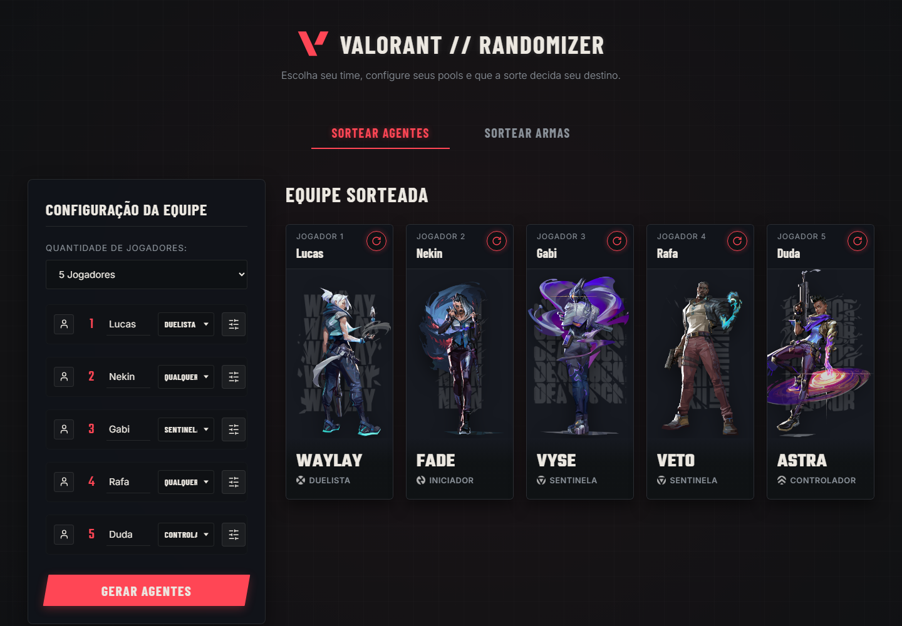
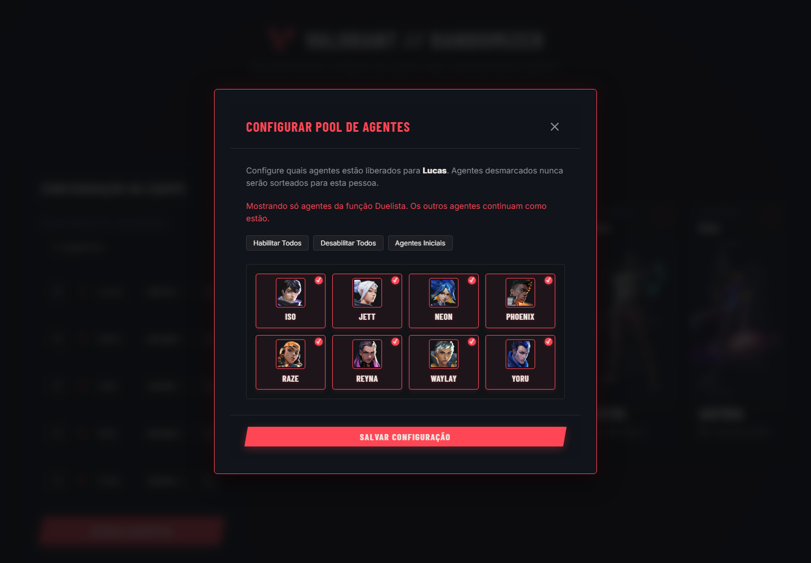
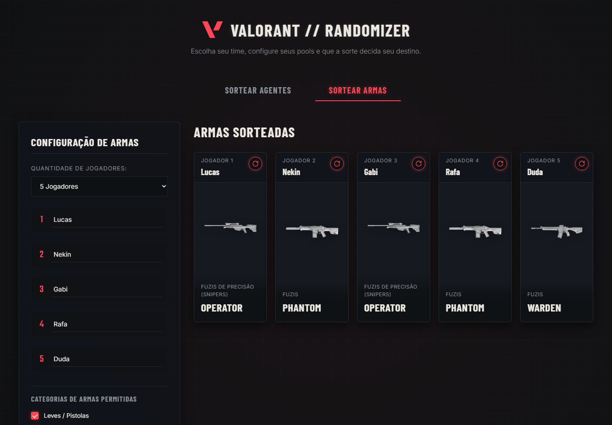

# Valorant Randomizer

Um sorteador de agentes e armas do Valorant. Eu fiz pra resolver um problema bem específico: toda sexta à noite, na hora de decidir quem joga com o quê, a conversa durava mais que a partida. Agora é só abrir o site, colocar o pessoal e deixar a sorte decidir.

Dá pra usar direto no navegador: [valorant-randomizer-eosin.vercel.app](https://valorant-randomizer-eosin.vercel.app/)



## O que ele faz

Você escolhe quantos jogadores vão jogar (de 1 a 5), dá um nome pra cada um e clica em gerar. Cada jogador recebe um agente diferente, sem repetir. Se alguém não gostou do resultado, dá pra sortear de novo só aquele jogador, sem mexer no resto do time.

Algumas coisas que fui adicionando porque senti falta:

- **Função por jogador.** Tem gente que só joga de duelista, e tem gente que topa qualquer coisa. Cada um escolhe a sua (Duelista, Sentinela, Iniciador, Controlador ou qualquer uma) e o sorteio respeita.
- **Pool de agentes por jogador.** Nem todo mundo tem todos os agentes liberados na conta. O botão de ajustes ao lado do nome abre a lista de agentes dele, e o que estiver desmarcado nunca é sorteado pra essa pessoa.
- **Perfis salvos.** Dá pra guardar o nome, a função e o pool de alguém e carregar depois com um clique, em vez de remarcar tudo toda vez.
- **Sorteio de armas.** Numa aba separada, com filtro por categoria (pistolas, SMGs, escopetas, fuzis, snipers, armas pesadas e faca). Aqui pode repetir arma, então todo mundo pode cair de Vandal.
- **Ele lembra do seu time.** Quantidade de jogadores, nomes, funções e pools ficam salvos no navegador, e na próxima vez que você abrir está tudo como deixou.

<p align="center">
  
  
</p>

À esquerda, o pool de um jogador que só joga de duelista. À direita, a aba de armas.

## Quando o sorteio não fecha

Se você deixar dois jogadores só com o mesmo agente liberado, não tem como sortear sem repetir. Em vez de dar um erro genérico, o site diz exatamente quem está disputando poucos agentes, pra você saber o que liberar.

Por baixo, o sorteio usa backtracking: quem tem menos opções escolhe primeiro, e se alguém ficar sem saída o algoritmo volta atrás e tenta outra combinação. Isso evita o problema de sortear um agente pra um jogador e descobrir no final que o próximo ficou sem nenhum.

## Os dados

Agentes, armas e imagens vêm da [valorant-api.com](https://valorant-api.com), em português. Os dados ficam em cache no navegador, e o site também carrega com uma lista embutida, então ele abre na hora e atualiza em segundo plano. Se a API estiver fora do ar, você nem percebe. Quando a Riot lança um agente novo, ele entra sozinho no pool de quem já tinha todos liberados.

## Como rodar

Não tem build nem dependência. Baixe o projeto e abra o `index.html` no navegador, só isso. Foi de propósito: eu queria que funcionasse com duplo clique e que fosse fácil de hospedar. O site publicado roda na Vercel como página estática.

Pra rodar os testes do sorteio (precisa do Node 18 ou mais novo):

```bash
node tests/solver.test.js
```

## Como está organizado

```text
valorant-randomizer/
├── index.html          estrutura da página e das janelas
├── styles.css          todo o visual
├── js/
│   ├── data.js         funções, categorias e a lista offline de agentes e armas
│   ├── solver.js       o algoritmo do sorteio (sem depender do navegador)
│   ├── storage.js      localStorage: perfis, cache e time salvo
│   ├── api.js          busca os dados na valorant-api.com
│   ├── state.js        estado do time e do catálogo
│   ├── dom.js          helpers de DOM, ícones, avisos e janelas
│   ├── ui.js           telas, cards e animação do sorteio
│   └── main.js         ponto de entrada
├── tests/
│   └── solver.test.js  testes do sorteio
└── docs/screenshots/   imagens usadas neste README
```

É HTML, CSS e JavaScript puros. Os scripts são carregados em ordem, sem módulos, justamente pra o arquivo abrir direto do disco.

## Acessibilidade

Dá pra usar tudo pelo teclado: as abas, as janelas (Esc fecha e o foco fica preso lá dentro) e as caixas de seleção. Se o sistema estiver configurado pra reduzir animações, o sorteio mostra o resultado direto, sem a roleta.

## Feito por

LuGoAn (Nekin). Se achar algum bug ou tiver uma ideia, abre uma issue aqui no repositório.

---

Projeto de fã, sem ligação com a Riot Games. Valorant e tudo que vem com ele pertencem à Riot. Imagens e dados vêm da valorant-api.com. Os nomes que aparecem nas capturas de tela são só de exemplo.
